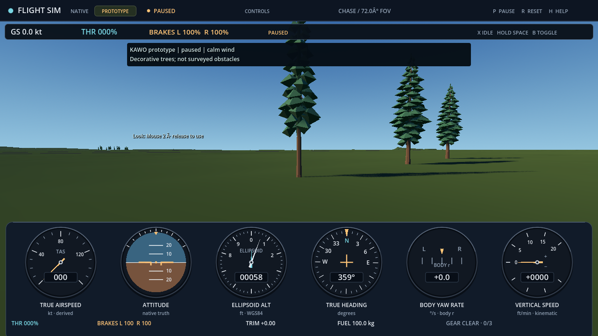

# KAWO decorative evergreen placement

The isolated Windows checks for [issue 264](https://github.com/brettbergin/flight-simulator/issues/264) passed against the actual compiled KAWO grid and three unchanged original LOD1 evergreen assets. The component passed 2,782 checks. The integrated focused run passed 59 source checks, 25 Scene checks and 55 synthetic archive-link reducer checks. These results cover deterministic placement, source-foot words, batch construction, origin transactions and Scene adoption/cleanup; they do not establish surveyed vegetation or aircraft obstacle behavior.

The actual component prepared 192 trees in nine MultiMesh batches: three original designs, each with bark, inner foliage and outer foliage. Each design has 64 instances. Assets remain the [accepted original prototype artwork](original-evergreens.md), with its existing MIT notice and twenty-file source inventory unchanged. There is no new acquired art, collision geometry, wind simulation, texture, alpha vegetation or automatic tree LOD. The native source fingerprint remains `a4ec21a8729a996f1f003bcd43c612fc28f8329ee02fcf990cd40e5b75f5aac9`; vegetation supplies presentation only.

The fixed placement controls precede the implementation and outputs. Candidate sites use the 32 m anchor-EUS lattice `x=-1536+32u, z=-1536+32v`, with integer `u,v` from 0 through 96, inside these six inclusive original grove rectangles. These are authored decorative areas, not mapped real trees.

| Grove | East range (m) | South range (m) |
| --- | --- | --- |
| 1 | -800 to -384 | -800 to -288 |
| 2 | 448 to 896 | -1088 to -512 |
| 3 | -1024 to -512 | 64 to 640 |
| 4 | 512 to 1024 | 128 to 768 |
| 5 | -320 to -64 | 480 to 1056 |
| 6 | 448 to 736 | 512 to 1088 |

Stable integer keys order candidates by `(key,v,u)`; design and yaw follow that fixed order. The balanced count is capped at 192 and preparation refuses fewer than 96 accepted sites. Each foot uses its original canonical 4 m vertex's exact Float32 height word, with no lift or interpolated replacement. All 49 vertices in its centered 7-by-7 neighborhood must be valid and finite, with height span at most 2 m. Exclusions use each compiled pavement footprint's integer-mm bounding box expanded by 112 m and each physical runway end's outward 1,500 m segment box expanded by 213 m. These conservative scenery exclusions are not regulatory obstacle-clearance surfaces. The [source controls](../../../tests/world/decoration/controls-v1.json) and [test notes](../../../tests/world/decoration/README.md) retain the exact boundary and ordering cases.

The decoration is a separate category-free origin participant alongside the canonical terrain. It binds the adopted session once and uses the existing shared origin transaction. It does not change terrain vertices, the terrain's 1,536 children, contact materials or native ground authority. Scene preparation remains provisional before old-flight retirement, and rejected asset preparation preserves the old flight. Synthetic-world selection and session retirement dispose the decoration through the existing lifecycle. The focused Scene run used actual native flights, while storage was disabled; the 55 reducer checks are synthetic scheduling controls, not persistence evidence. The separate [world journey evidence](kawo-world-journey.md) describes the actual storage test and its limits.

The later graphical run used Godot 4.7.2 Forward+/Vulkan on an NVIDIA GeForce RTX 3090 and retained 32 original PNG captures. The capture run passed, joined native and audio, exited zero with empty stderr, and preserved its source/control seals. Its elapsed process time was 28.048 seconds and sampled peak working set was 1,450,364,928 bytes. This includes the isolated capture workload; it is not an FPS, worst-case memory or gameplay loading benchmark.

Root inspected the original cockpit/chase, canopy, close-trunk and representative zoom images across the retained iterations. No crack or black foliage mass was apparent in those inspected views; the art remains sparse and visibly stylized. An initial 31-view run left the first trunk foot behind the HUD. A new camera-only view, fixed to the same first deterministic placement and camera position with its target lowered from foot+8 m to foot+1 m, exposed trunk contact and ground shadows. The final run retained all previous views and this additional view, with all 32 original image sizes/hashes independently reread. Visible trunks meet the terrain in that inspected view. This is bounded image inspection, not universal contact/flicker/culling or arbitrary gameplay stability acceptance. The 24 paused zoom actions do not establish a flown flight or pilot review.

Retained receipt identities are:

| Observation | SHA-256 |
| --- | --- |
| Actual component result, 2,782 checks | `1a140205c9630a0cdd76dde52d6ece52f1eb098c99a60d844268f12c9ac5ce09` |
| Actual component process | `670005962758c9ba575808d5e2cfa1a4f3972bcdf824b46756efdd416e126989` |
| Focused source/Scene/reducer run | `dc3d90773d29a4c7ffd3f34ef894da06747fc14015b706c7462332472d216fa2` |
| Graphical process | `7405d9ed21da654c2c2dbcf785d102494b20fe22dc180d5c2e86a73ef2a47732` |
| Graphical capture/seal result | `64efb9313959b2fdb6e5d7aa866d4e5341ed055bd21782f1a635a3a2be214fa5` |

The earlier headless dummy-renderer failure remains retained. It did not establish usable actual MultiMesh readback and was not relabeled as graphical success; the later component used the actual graphical renderer. Source-foot checks and numerical limits were retained.

These isolated runs do not yet prove exported raw-GLB FileAccess/hash availability and imported-resource loading in a packaged game. Installed delivery, sustained frame performance, owner/pilot evaluation and broader P4 acceptance remain open. The underlying geographic approximation and [terrain source limits](kawo-terrain-compilation.md) also remain unchanged. Decorative trees are not surveyed obstacles, operational airport data or aviation training-credit evidence.

The unprocessed views below retain the normal HUD and native paused state.

