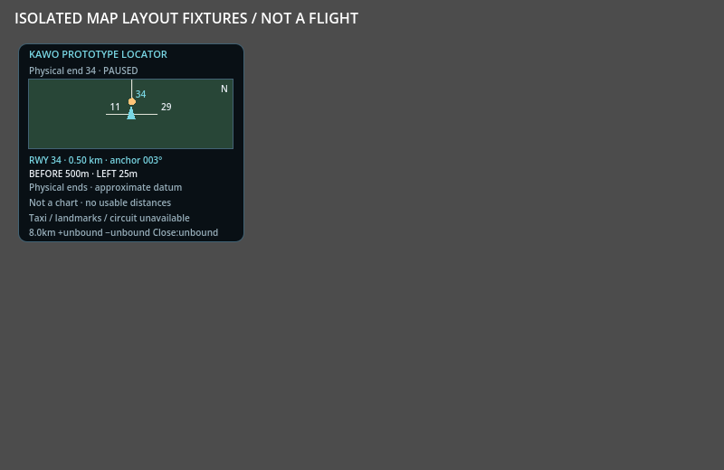
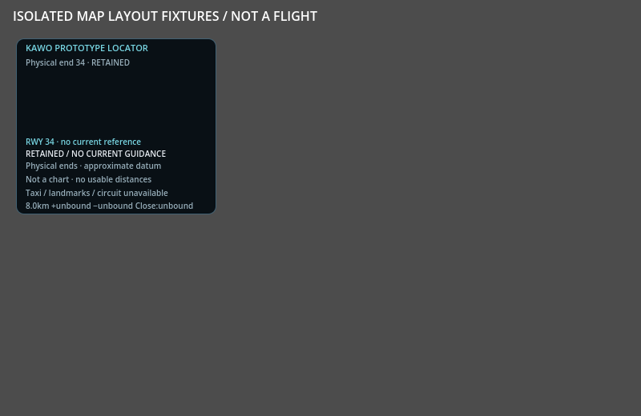
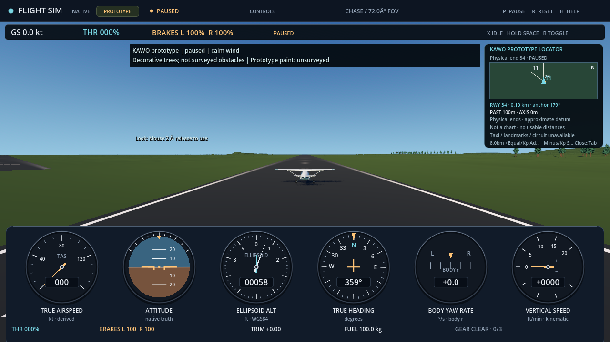

# KAWO physical-runway locator readings

[Issue269](https://github.com/brettbergin/flight-simulator/issues/269) exposes
the existing map's planar range, anchor-frame bearing and along/across position
relative to the selected compiled physical runway end. The pilot can distinguish
BEFORE/PAST and LEFT/RIGHT/AXIS while selecting 11/29/16/34. These are geometric
references, not usable runway distances, thresholds, a glidepath or steering
commands. The bearing uses the common anchor EUS plane; it is not magnetic or
aircraft-local true heading.

The production delta is confined to formatting and drawing in
`app/proof/interactive/flight_map.gd`. The existing numeric calculations,
geometry admission, selection, source bytes, native/facade/recording/controls,
input mappings, aircraft and terrain are unchanged. Retained or unavailable
state displays no current numeric reference. The compact layout keeps its
250x220 minimum and uses extra vertical space when supplied; the ordinary map
also shows the same readings. Complete explanations remain in the tooltip.

## Retained observations

The manual [layout capture](../../../tests/world/kawo-locator/README.md) uses
hand-derived cardinal geometry and synthetic map states. It is not a native
flight or an admitted operational airport. The same 60 cases cover all four
ends, before/left, past/right, coincident position, retained and unavailable
state at 250x220, 320x220 and 430x320. The corrected run passed 513 checks and
wrote eight original images on OpenGL3/RTX3090. Root rehashed and inspected all
eight, including the ordinary map. The complete original layout receipt is
[retained here](kawo-locator/layout-receipt.json), SHA256
`455429e2e80ac94ea08d2ce81f577ed853dad1d5440d970a19da3011b3f00a12`.

The first run failed all 60 footer-fit checks: the third caveat line was hidden.
An independent font observation measured a 48-pixel minimum for its three lines
(14-pixel line height plus 3-pixel spacing). The first layout supplied 45 pixels.
Moving the footer up three pixels and providing 48 fixed the product; the 513
checks, case roster and fit gate were unchanged. The
[failed minimum-size capture](kawo-locator/failed-minimum.png) remains retained.

The actual Scene capture separately completed 47 paused KAWO images: the prior
43 camera/paint/origin views plus four ordinary map selections. Every new row
passed actual font/layout checks at the game's 250x220 dock. All source hashes,
native/readback/recording/control/resource guards and origin transactions passed;
native and audio joined. Root inspected all four original locator images and
independently rehashed all 47 images. The
[original Scene receipt](kawo-locator/scene-capture.json) SHA256 is
`f711fb184179c61d55612297aabfbfdec7679b3fa456cf827265949db1928a78`.
These observations used the authoring executable, Vulkan and the RTX3090,
with no advancing tick, hardware input, profile storage or aircraft teleport.
Fixture and actual-Scene evidence remain distinct.

The reviewed map source SHA256 is
`d87b6f6c396b5461e8ee33bcfd6d8f07a650071c50cfe51d38b354dc30e3dd63`.
The actual Scene capture source is
`88d5db191ff89e55596aa3f3b3f9c2148f17a29565b484af58aec51b22e4af05`.
Neither changes the original aircraft, the independent physical controls or
the previous terrain/paint qualification.

## Remaining gates

Final-head CI and Windows exported-player delivery must be recorded in the PR;
the observations above do not substitute for them. No installed player or owner
profile was changed. The old synthetic automated driver's off-pavement impact
is retained under [issue261](https://github.com/brettbergin/flight-simulator/issues/261);
this display work does not establish a planned geographic runway landing or
braking envelope. Geographic source accuracy, manual flight, aircraft/pilot and
broad phase acceptance remain open. The map supplies no operational airport,
traffic-pattern, taxiway, obstacle or navigation coverage claim.
