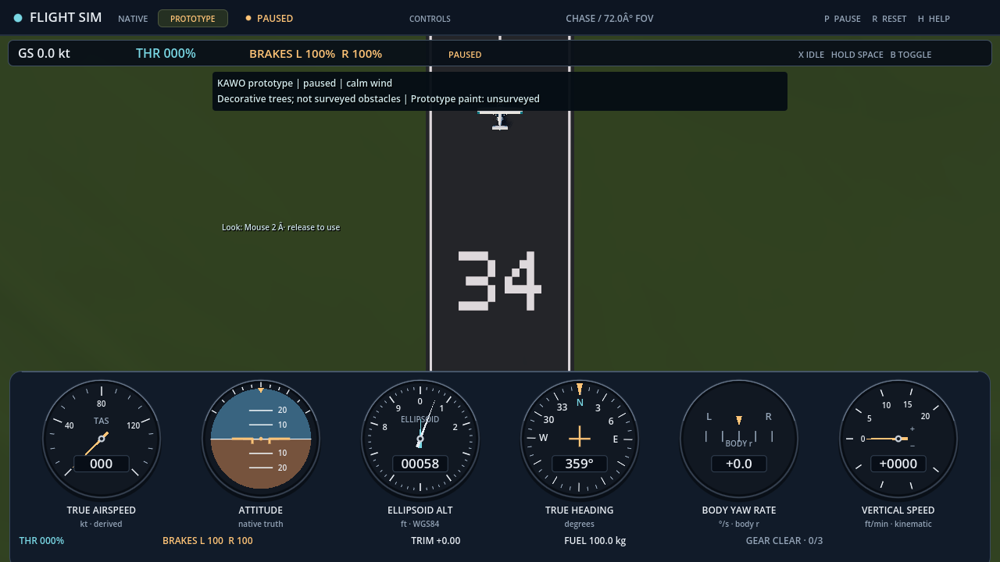
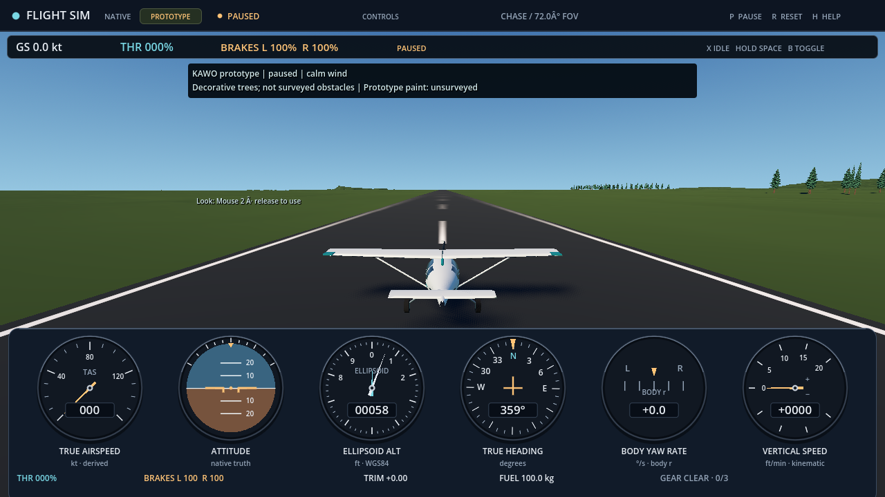
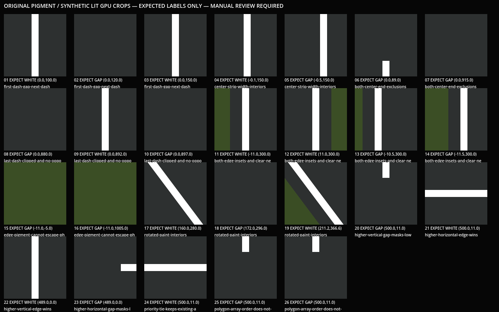

# Original prototype KAWO runway paint

[Issue #267](https://github.com/brettbergin/flight-simulator/issues/267) adds
original white centerline dashes, pavement-edge stripes and identifiers
**11/29/16/34** to the existing canonical terrain material. It introduces no
extra mesh, raised decal, collision or terrain sample. The admitted physical
endpoints define the presentation frame; they are **not operational thresholds**.
The original synthetic airfield and authoritative native terrain remain separate.

This is original MIT artwork, with no external font, image or texture. Its
dimensions are presentation choices, not surveyed or regulatory markings:
0.45 m stripes, 20 m dashes separated by 30 m gaps, 90 m centerline end exclusions,
1 m edge inset, and original 5x7 digits 12 m high and 7.5 m wide, separated by
2 m in a block beginning 60 m inward. Both number blocks face the arriving pilot.
The single dash phase starts at the first-listed physical end. Paint follows
the winning pavement polygon, including its existing priority and ID tie rule;
marks from a losing polygon are not combined with it.

## Bounded checks and observations

The reviewed source and independent controls retain distinct evidence scopes:

| Evidence | Recorded result | Limit |
| --- | --- | --- |
| Headless geometric controls | 132 checks passed | Local frames, end-number boxes, ID association, clipping and layout refusal; no rendered-pixel or flight claim |
| Real-renderer material scope | 156 total checks passed, including the same 132 geometry checks | Actual uniform readbacks; not shader pixel correctness |
| Synthetic GPU board | 26 controls inspected by Root; original board image rehashed | Clear pigment/gap, glyph and synthetic crossing-priority observations, not a geographic runway intersection or all-distance legibility proof |
| Actual Scene view suite | 43 original Forward+/Vulkan images captured; native/audio joined; all source/authority/resource guards passed | Paused camera diagnostics, including eight number views, 24 zoom steps and three public-origin views; no manual flight or exported GPU claim |
| Existing terrain regression | 396 reader checks and 4,560,418 world checks passed; 10,000 scheduled transactions, 8,125 commits | Original full mesh/indices and frozen origin budgets; CPU observations, not universal GPU accuracy |

The independent hand-authored controls preceded implementation. They use small
rectangular and crossing fixtures, not an operational airport-marking reference.
Their geometry budget applies to those rational binary64 fixtures only; it is
not a geographic, Float32 or image tolerance. See the
[focused test instructions](../../../tests/world/runway-paint/README.md).

The first qualification wrapper failed on 26 board-caption formatting errors;
the geometry/material groups were clean. The second board changed labels only
and passed. These failed attempts remain retained. The first actual Scene
capture then exposed an invalid capture premise: the admitted physical runway
segments do not cross. Their supporting lines must not be treated as intersecting
pavement, and neither terrain nor source geometry is being changed to fit the
capture. The corrected scope retains 32 ordinary views plus eight number views. A separate
three-view addendum observes the same number before, during and after a fixed
EUS (100, 0, 64) m origin offset through the existing public registry. A second
attempt stopped after 41 views on an exact diagnostic-camera basis invariant.
Its cause was not established; source review ruled out the initially suspected
translated parent. Constructing the diagnostic camera's complete prescribed
global pose made it reproducible without relaxing that invariant. The third
attempt completed all 43 views, with exact native/readback/recording/controls,
mesh-array/resource/material-uniform and raw-source checks, and exact CPU
participant-transform return. Both failed attempts remain retained.
Synthetic crossing controls remain useful for the material winner rule; source
accuracy and actual 3D geographic relationships remain separate open gates.

The recorded source/evidence hashes are:

| Artifact | SHA256 |
| --- | --- |
| Reviewed KawoWorld paint/glyph source | `83e0bbcbed3ff80917e6f149db681bd613c623799b404411fd1d6906176e9c44` |
| Focused checks source | `b4f8485b2558d3defc2a75850bc5f790a154e6c30e3b589172bc3b1f05803359` |
| Independent controls | `150f64031548bbbe38930c842315dacb89513dd857184ae79e8cad6467c78a18` |
| Geometry log | `75cade25feeeb1dd82e30a2b2ab1308d9c74102fdbbe5eb769e904865bf7e8c8` |
| Material log | `92dc0c9202deef0418c88ef7ac2e8e4bb397faa49b2b20637c58bc65263d4a31` |
| Corrected GPU-board capture receipt | `08f1cf9d42a45fd4673eaef98294b1f8479596930e95b80e52b21abe19f7998b` |
| Original GPU-board image | `d65680be6a8c9ced439923bdbbfb407cfc6addefc0bdd54fb2dcf5934d8f5148` |
| Final 43-view capture source | `10a16ce23a321f32cc74a4779c5042108943a2f7837c51bfe06fda0d5ca4b50c` |
| Actual 43-view capture receipt | `43622b5d85bdbe3a6e1261833df9b4362d21f4237d79b3d661f975acd24fe6a7` |
| Existing full-mesh/origin regression log | `c85d71a1822be2a45b391fe1aaac0c21931024fd3709e7be4187239c7470870d` |

Counts and inspections above record Root's retained bounded observations. They
are not fresh final-head CI or independently completed package qualification.
Root inspected all four identifiers from above and inbound diagnostics, the
cockpit/edge views, representative zoom steps and all three origin images.
The numbers are correctly oriented and the original edge/centerline pigment
remains on the existing pavement. Thin distant strokes fade; this bounded
inspection establishes no universal flicker-free or all-distance readability claim.
All 43 original image hashes were independently rechecked. The retained
[raw scene receipt](runway-paint/scene-capture.json) records exact poses, renderer,
authority and source identities. Representative unchanged originals follow:

## Preserved authority and remaining gates

The source keeps the existing lighting correction, terrain vertices/indices,
1,536 terrain children, canonical origin, source payload, native contact,
aircraft, controls, datum and storage interfaces. Invalid presentation layout
must reject before replacing the old flight. Shader antialiasing and thin-stroke
fade are visual estimates; universal readability or flicker freedom is not proven.

The actual observations are bounded paused views, including low-angle chase/zoom
images and public-origin rebasing. Applicable Scene/staging tests, final-head
protected CI, Windows delivery and measured resource evidence remain separately
required. Three-context headless geometry checks are wired into normal packaging;
actual material readbacks and pixel observations remain separate from them.
Manual taxi/circuit/landing, source/geographic accuracy, operational paint,
aircraft/pilot evaluation and broad #243/P3/P4 acceptance remain open.

There are no threshold bars, displaced thresholds, aiming points, touchdown-zone
marks, lights, taxiway signs or operational-distance guidance. The visible
unsurveyed-scenery caveat must cover this paint. Future source-backed airport
markings require their own rights, applicability, geometry and validation work;
these original dimensions are not a substitute.
