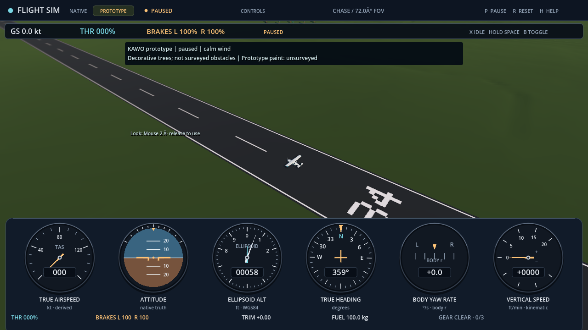
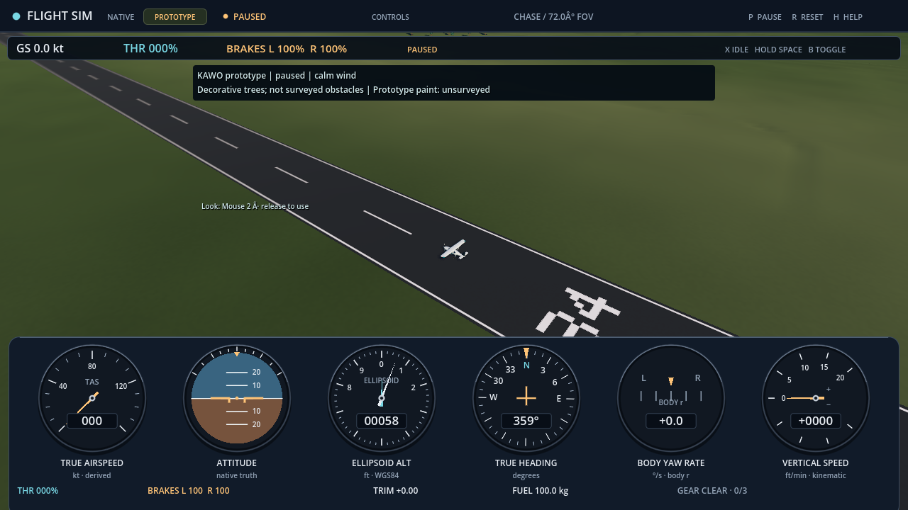
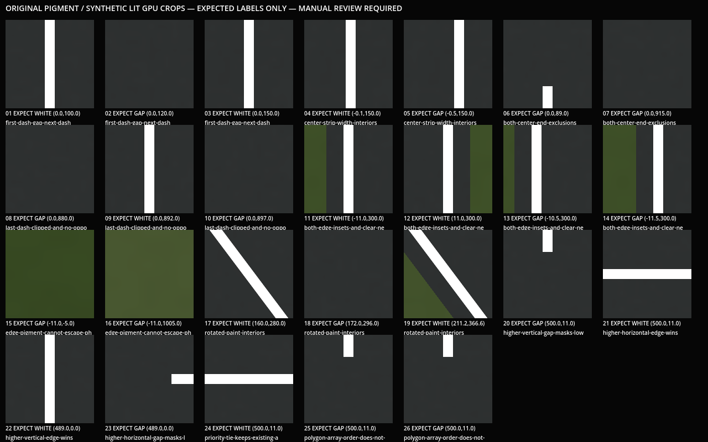

# KAWO original surface appearance

[Issue271](https://github.com/brettbergin/flight-simulator/issues/271) replaces
the almost uniform grass and constant pavement pigment with original, static
surface detail. This is decorative artwork, not measured land cover, pavement
condition, runway wear or a different contact/friction model. The existing KAWO
prototype limits remain visible in the game.

The production delta is wholly inside `KawoWorld.SHADER_SOURCE`. Grass uses
continuous value noise with 180 m, 23 m and 0.8 m cells, a restrained warm color
blend and a 0.80–1.24 brightness envelope. Pavement uses 0.35 m aggregate with a
0.97–1.03 multiplier. Every scale fades toward its mean as the existing pixel
footprint estimate approaches the cell size. All coordinates come from the
unchanged canonical vertex XZ; time and camera/origin position do not seed it.
These scales and colors were fixed before the captures as original art choices.

The existing winning pavement mask and unchanged white paint compose last.
No texture, alpha, displacement, normal, roughness, lighting, material uniform,
mesh, terrain sample, tree placement, native state, control, recorder, profile,
source payload or public interface changes. Full nonshader source equality was
checked against the prior qualified World. An independent source review found
no actionable source defect; this is not aircraft or visual acceptance.

## Actual observations

The unchanged [actual Scene capture](../../../tests/world/terrain/kawo_gpu_capture.gd)
completed the same 47 paused views on Forward+/Vulkan and the RTX3090. All source,
native/readback/control/recording/resource and public-origin guards passed;
native and audio joined. No physics tick advanced and no player storage opened.
Before/after source comparisons found exactly one changed capture input: the
World shader owner. Native values matched except fresh session IDs; runway
frames and tree placements matched exactly. All 47 camera tuples matched except
their process-specific parent node ID. Every original image hash was reread.

Root inspected the original before/after runway overview, new runway edge,
canopy-east, trunk-foot, 34 inbound, cockpit/chase, ordinary zoom frames 00/11/23
and the three public-origin before/shifted/returned views. The inspected images
show ground variation and preserved pavement/markings, without an apparent
chunk-edge or pigment jump. Sampled paused frames cannot establish real-time
flicker absence or universal seam-free rendering. The surroundings remain sparse.

The unchanged independent paint controls
`150f64031548bbbe38930c842315dacb89513dd857184ae79e8cad6467c78a18`
passed 132 geometry assertions and 156 separate real-renderer material assertions
(132 geometry plus 24 uniform readbacks). A synthetic lit board retained all
26 predeclared white/gap/crossing crops and 27 original images. Root inspected
all 26 positions in the original board; the expected white/gap/winner behavior
was visually consistent. The board records raw pixels and explicitly has no
automatic shader verdict. It is not native flight or operational paint evidence.

The first paint harness attempt stopped during staging, before engine execution:
PowerShell concatenation/comma precedence joined two path fields. The corrected
parenthesized harness used a new directory and passed. Both attempts remain
retained; no production code, frozen control or acceptance budget changed.

The capture/import processes took 39.2092234/4.2432613 seconds respectively.
Those include preparation, shader compilation and PNG readback/writes. They are
not FPS, loading-only, steady-state GPU or memory measurements. No new performance
or source-accuracy claim follows from those durations.

## Reproduction and remaining gates

The [derived observation summary](kawo-surface/observations.json) retains the
original receipt hashes, source hashes, all 47 before/after image hashes and
explicit comparison scope. It is a summary, not a replacement raw receipt.
The production World SHA256 is
`cc1f884582264e265e7a943b0b6b6ebd7ed626340cc0344e291f716def48bc84`;
the unchanged actual Scene capture source is
`88d5db191ff89e55596aa3f3b3f9c2148f17a29565b484af58aec51b22e4af05`.
The summary SHA256 is
`4447871f5d2573ed0a6ac55d29f4e16781e911150ad46e6fd56285b1ab3e40d4`.
Use the existing Scene capture route with this World for native paused views;
the [manual paint board instructions](../../../tests/world/surface/README.md)
and original capture source reproduce the separate synthetic crops.

Final-head CI and fresh Windows export/source-rebuilt-library delivery must be
recorded in the PR separately. No installed game or normal owner profile was
updated. This does not close geographic flight/contact #261, renderer #262,
journey #263, vegetation #264, C172/pilot or P4 gates. Taxiways, airport buildings,
water, obstacle coverage and sourced regional landmarks remain separate work.
