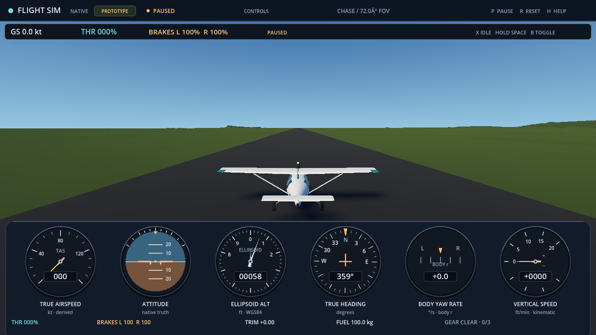
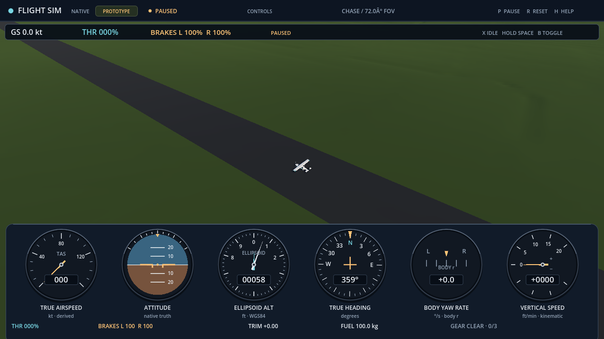

# Canonical KAWO terrain presentation

The isolated Windows presentation checks for [issue 262](https://github.com/brettbergin/flight-simulator/issues/262) passed with Godot 4.7.2 (`ed1daf0bf`). The reader passed 396 synthetic codec/admission/copied-view checks. The world test passed 4,560,418 checks against the actual compiled payload and geometry, including two full mesh-array audits and all 10,000 predeclared origin attempts with 8,125 successful commits. Each process joined with exit zero, empty stderr and no engine/script errors; retained source/input observations were unchanged. These are CPU-side component results. Integrated flight, GPU appearance and delivery acceptance remain separate.

The implementation follows the checked [runtime contract](../../contracts/world/kawo-runtime-v1.md), [grid core](../../contracts/world/resident-grid-core-v1.md) and [payload codec](../../contracts/world/resident-grid-codec-v1.md). The reader validates the complete externally bound payload: raw anchor agreement, closed structure, material and polygon IDs, friction, clockwise simple rings, validity/sentinels, lattice/count/bounds, exact height span and both exact triangle gradients. It preserves signed-zero and admitted Float32 source words in copied owned views. Conservative floating filters resolve values far from gradient/span boundaries; bounded integer arithmetic decides borderline cases without changing admission limits. Raw-bit origin/friction checks add no caller floating-environment precondition to payload admission.

The renderer prepares all 1,536 fixed 64-cell chunks as an unattached provisional root and binds the actual session ID once. The complete mesh contains 6,489,600 vertex entries and 37,748,736 indices. Chunk boundaries retain their original shared grid addresses, source Float32 heights, P00–P11 diagonal and winding. Identity children share one binary64-derived, once-narrowed translation through the existing Origin prepare/commit protocol. There is no independent collider, alternate height field, terrain LOD, pavement flattening or vertex-displacing shader. Procedural pigment follows the compiled footprints on those same facets; lighting normals and pigment do not supply native contact or material authority.

The actual-source test audited every vertex/index entry before and after the origin sequence. It also exercised provisional binding, strict argument types, copied source ownership, unchanged state after rejected transactions, exact anchor returns and camera height at an original source vertex. The predeclared sequence contained 8,125 successful commits, 625 nonfinite-origin refusals, 625 out-of-domain refusals and 625 stale direct-plan refusals. The existing registry explicitly marked the six other presentation categories absent in this component-only test; it did not substitute fake ownship, cockpit, camera, light, audio or particle participants.

Independent projection/model-space checks used the existing fixed tolerances: `2^-20 m` per projection component, `1/256 m` per CPU-model component and `1/128 m` Euclidean, with rebase-pair recovery limits `1/128 m` per component and `1/64 m` Euclidean. These are bounded CPU arithmetic checks. They do not measure GPU pixels or establish geometric source accuracy. Camera floor queries use translated half-open ownership and original piecewise triangle heights, requiring a bound committed root and intact hierarchy; outside/missing geometry returns failure and never alters aircraft physics.

The actual world process took 98.319 seconds and its sampled peak working set was 453,431,296 bytes. This observation includes two world preparations, the extensive transaction loop and full array audits; it is not a gameplay loading-time, worst-case memory or frame-rate benchmark. The reader process took 0.317 seconds. The isolated editor import took 2.403 seconds and had a separate sampled peak working set of 641,433,600 bytes. The reader's short process had no nonzero sampled peak, so no reader peak-memory claim is made.

The qualified source identities are:

| Source | Bytes | SHA-256 |
| --- | ---: | --- |
| `app/world/terrain/resident_grid_reader.gd` | 17,427 | `0704becbd2423f4f7f42f3ca978440353249ab06e28409c0bd1e5f855b880bd2` |
| `app/world/terrain/kawo_world.gd` | 19,051 | `b54d2ef43575b9d718d26e62470ab9b723584855151209018f4f0ec6291030b8` |
| `tests/world/terrain/reader_checks.gd` | 8,903 | `5a437fc0f15204a0f3308cfdbf4e89d798fc17afdd221e0a84d82e221cc0c106` |
| `tests/world/terrain/world_test.gd` | 15,676 | `8037a5e291e81f94b2067fe774bedb6a592fe740180de8b992da6223f11a75a1` |

The retained Godot executable was 180,858,888 bytes, SHA-256 `ab1824f85bfd8e0e4128182c000c4003a3e042245b2967848d089b2a04b22424`. The actual payload was 25,973,686 bytes, SHA-256 `b2c53308fdc427900d84b541aff51ba66cbb71bc483fcee0ea16d067dbd15cfb`; its 22,937-byte compile receipt was `cb1e0b28384aeb1c11173d991b5790a8a16e64953c2c479be6b07136c5f489f0`. The [compilation evidence](kawo-terrain-compilation.md) retains their offline source/product limits.

Earlier failed attempts remain retained. The first reader attempt emitted engine errors because its test helper hashed the empty truncated prefix; the corrected helper uses the independently known empty SHA-256 without changing refusal expectations. Initial world preparation exposed serialized integer footprint tokens arriving as Godot floats; only finite exactly integral, in-range footprint coordinates are now copied to owned integers before exact ring comparison. A later attempt exposed a decimal FP witness parsed below the intended half-ULP. The witness and Float32-subnormal unit now use their exact binary64 words, with independent word checks. No geometry, source words, admission limits or numerical tolerances were relaxed to obtain the passing result.

Native/render association in a live flight, Players/history/Save integration, component/link and package closure, GPU visual review and pilot evaluation are not established by this isolated suite. The compiled geographic data remains approximate under its unresolved source-frame policy. This evidence establishes neither operational airport suitability, aircraft fidelity nor aviation training credit.

## Actual paused GPU views and lighting correction

A later isolated actual Scene run used Godot 4.7.2 Forward+/Vulkan on the
NVIDIA GeForce RTX 3090. It produced 28 original 1280x720 ViewportImage PNGs:
ordinary cockpit/chase presets, two explicitly camera-only oblique diagnostics,
and 24 paused chase zoom steps through the existing view action. Every capture
preserved the same native tick-zero paused readback, recorder, held commands,
source binding, origin and ownship/cockpit transforms. Storage was disabled
through the existing Scene seam; the installed game and owner's profile were
not opened. Native and audio joined, the child exited zero with empty stderr,
and all retained source/tool and staged-copy seals remained unchanged.

The first retained GPU baseline exposed nearly black terrain. The canonical
triangle order and upward vertex normals were preserved. A fragment-only
world-up hemisphere correction prevents the two-sided material's back-face
normal inversion; the pinned [Godot shader source](https://github.com/godotengine/godot/blob/ed1daf0bf/servers/rendering/renderer_rd/shaders/forward_clustered/scene_forward_clustered.glsl#L1168-L1174)
shows that inversion before the custom fragment. An intermediate repeat showed
readable pavement and shadows. The fixed `original.terrain-prototype` ID was
then mapped to the existing green pigment instead of the brown unknown-ID
fallback. This is original cosmetic paint, not measured land-cover data.
Neither change alters vertices, topology, payload words, friction or physics.

The final World source is 19,446 bytes, SHA-256
`c93cff2a3749d0bc9b9ee4c0a3ab62aa73b01ee17e313908d5506a02e94e7584`.
The CPU source table above records the earlier geometry/transaction suite;
these subsequent deltas only affect fragment lighting and pigment selection.
The same Scene source checks and native replacement checks passed after the
lighting correction (59 source, 24 Scene and 55 reducer checks).

The final capture receipt raw SHA-256 is
`80f6951208d55a5f6662b4bebc97868e9be725dc984f8dabe612abfb10466f21`;
the external graphical supervisor receipt is
`0e6aee6e63aafd624d9773b19470df8f617e5f0ac563d08e362b002c5585844a`.
All 28 original image hashes were independently reread and matched. The child
took 25.861 seconds, including actual Scene preparations and captures, with
sampled peak working set 1,452,474,368 bytes. This is not loading-only timing,
steady-state memory or frame-rate evidence.

Root inspected the original cockpit/chase/oblique images and representative
zoom steps. The original files above are unprocessed. Pavement/ground contrast
and the aircraft shadow are visible after the correction; no terrain chunk
crack was apparent in those inspected views. The view is still sparse and lacks
operational markings, taxiways, airport buildings and surveyed obstacles.
This bounded inspection does not establish universal seam/flicker absence,
GPU geometric precision, a flown circuit, hardware input, installed-package
visual equivalence or pilot acceptance. The reproducible capture source is
[the GPU diagnostic](../../../tests/world/terrain/kawo_gpu_capture.gd); stage it
as `res://kawo_gpu_capture.gd` in a fresh complete preview project and provide
a fresh absolute image-output directory after `--`. Its two oblique shots are
explicit diagnostic camera offsets, not flight or changed aircraft poses.
