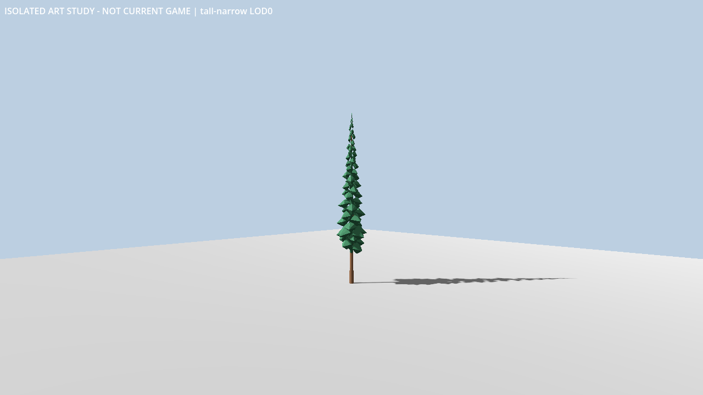
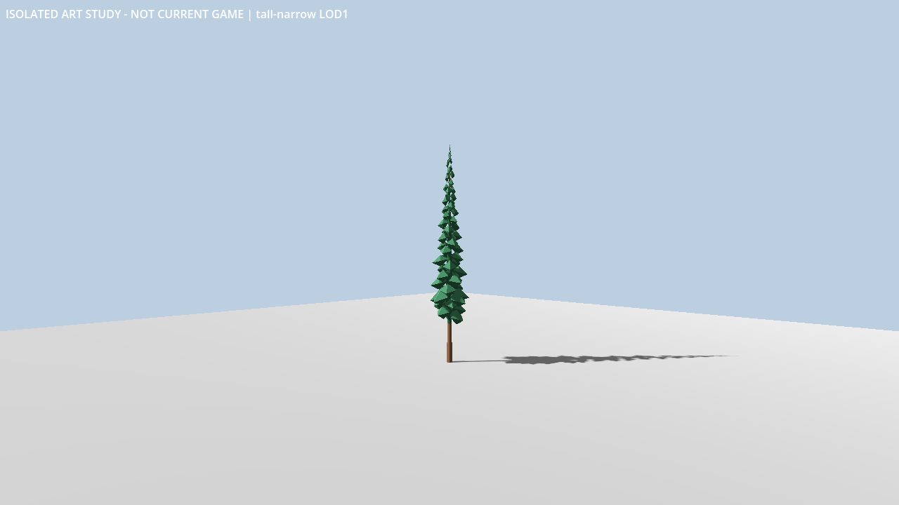
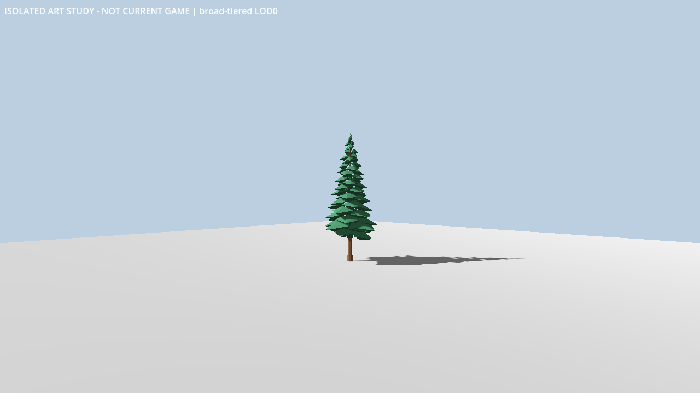
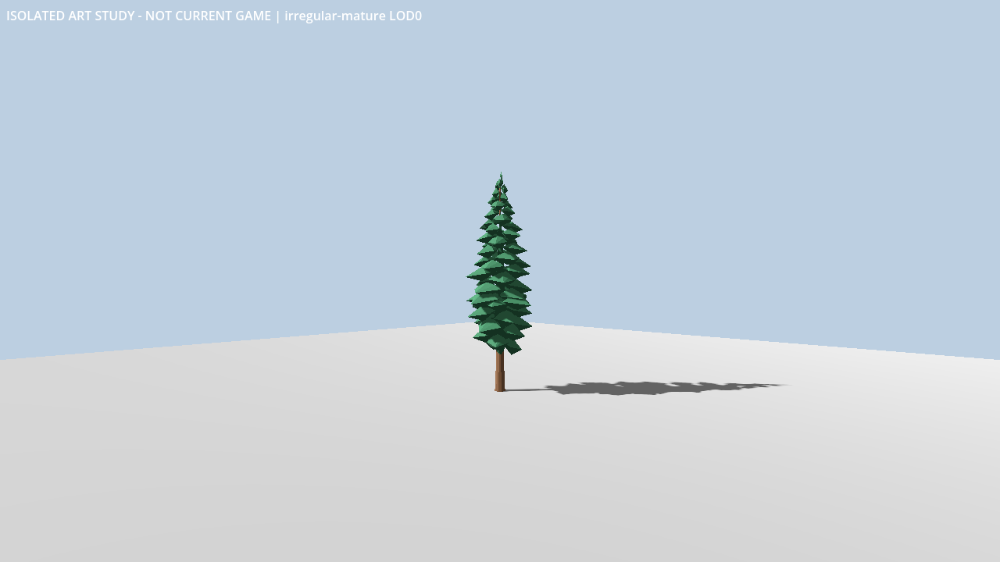

# Original evergreen asset delivery

Issue [#252](https://github.com/brettbergin/flight-simulator/issues/252) delivers three original decorative evergreen designs, each with two explicit LODs, under the [checked brief](../../contracts/world/original-evergreens-v1.md). The fourth candidate passed structural, editable-source/export and isolated Godot checks, followed by independent image review. Acceptance is limited to **faceted prototype source art**. Runtime placement, forest performance, geographic vegetation, collisions, airport operational completeness and phase acceptance remain separate.

## Adopted source

The [source leaf](../../../assets_source/environment/original-evergreens-v1/README.md) contains the generator, editable Blender source, six GLBs and actual source receipt. Original geometry uses three opaque materials with no textures, external images, alpha cards, wind or animation. Each crown has 64 irregular radial branch clumps; both authored LODs retain the same clump layout and extrema. Dimensions are original art, not botanical or airport measurements.

| Design | Height × width × depth | LOD0 triangles / stored vertices | LOD1 triangles / stored vertices |
| --- | --- | --- | --- |
| Tall narrow | 25 × 5 × 5 m | 3936 / 11808 | 864 / 2592 |
| Broad tiered | 19 × 9.5 × 9 m | 3936 / 11808 | 864 / 2592 |
| Irregular mature | 22.5 × 8.5 × 8 m | 3936 / 11808 | 864 / 2592 |

The six exports total 1,139,200 bytes. The editable blend is 1,329,976 bytes. The [rights evidence](../../../third_party/licenses/evidence/original-evergreens-v1.md), full MIT notice and adjacent inventory retain exact adopted-file identities. Tool licenses remain separate from original output rights.

## Executed checks and review

The [independent checker](../../../tools/benchmark/pipeline/environment_trees/README.md) uses hand-authored box references frozen before the art generator. Twenty standard-library structural/bundle tests passed, including accepted boundary cases and malformed framing, normals, bounds, topology, materials and source-receipt refusals. Boxes can pass structure; they are deliberately not accepted tree artwork. CI reproduces the frozen reference, runs those tests and checks the actual adopted bundle.

Root reviewed sources before execution. Actual authoring used Blender **4.5.14 LTS**, build `62c1db4208e8`, in a fresh output with factory startup and automatic script execution disabled. A separate inspection opened the saved blend and compared all six roots, eighteen mesh children, stored geometry, materials, transforms and source/export correspondence. It also checked for external libraries, executable text and other undeclared source content. These passed without post-export geometry fitting or repaired exports.

The isolated verifier used Godot **4.7.2 stable official**, build `ed1daf0bf001b61586d9930840f2f1394092c079`, Compatibility/OpenGL3. It imported only these assets into a separate proof project. Automatic import LODs and viewport LOD were disabled. Actual resource/readback checks covered the complete authored hierarchy, exact imported Float32 geometry, material observations, source identities and nondegenerate triangles. The importer-added identity filename wrapper was admitted only after inspection of all six actual hierarchies; authored roots and meshes remained checked.

Visible GPU captures passed the fixed background/control checks and retained **36 fixed views**: all six assets at azimuths 45°/225° and ranges 50/150/400 m. Six additional fixed-LOD camera sequences each contain 301 inclusive samples over five seconds of camera time, from 50 to 400 m at 60 Hz. Saving these images does not measure real-time rendering performance.

An independent reviewer inspected every original fixed view. Root and the reviewer also inspected all twelve derived approach sheets, covering all 1,806 sequence frames once, and opened selected original frames directly, including far-range trunk outliers. The sheets use recorded geometry/camera projections and aspect-preserving resized crops; originals remain authoritative. This is a sequence overview review, **not playback or proof that flicker is absent**. Crown mass, pose and paired-LOD correspondence were acceptable for this bounded prototype. Far foliage aliases, near surfaces remain angular, and thin trunks can become interrupted at subpixel widths. Those limits remain visible rather than being described as photorealism or temporal stability.

Earlier three candidates passed technical checks but failed visual review for sparse pods, a smooth candle-like crown or stacked canopy plates/LOD mass loss. They were not adopted. Failed proof/overview attempts and their diagnostic logs were preserved. Narrow corrections handled the actual identity import wrapper, an independent Float32 material-word control, duplicate JSON decimal parsing, JSON numeric array types, and the distinction between the Godot console launcher and its sibling engine. Frozen asset limits, independent fixtures and geometry tolerances were not loosened.

## Evidence identities

All digests are SHA256 of actual retained bytes. Local machine paths, profiles and original proof directories are excluded from this public summary.

| Evidence | SHA256 |
| --- | --- |
| Checked brief | `eb3aea53ba869b80117eaed952ac1f65ec2e1e3df1fe731524715fd7e3ae40d6` |
| Adopted generator | `6e4025f50772edb4539cea063ed4050b4f4315b329c54d1e9db9895d3a3b20b9` |
| Editable blend | `115293cba07c50eafd5616ff7d5c8a86738e878b3e5116eeb3e560244f464145` |
| Actual source receipt | `d9d236d81dd9f4fc635670804c9f19208449c6e7e6c73519af06c2fdd44349fb` |
| Final twenty-file rights inventory | `d7ede5ce25ba3912ee98abc801d73ecd9edee01c87d24dcb16412e5c8e563e3b` |
| Independent structural checker | `cd333f44967036f33004b1a277f1b9a1440a5375f432d3a9aa0d78ae30f545a8` |
| Independent tests | `c97e2291d977959e0b919bdabb30170d2b30781b00340f2e23739859c1be1cab` |
| Frozen hand reference | `1d867f93e07dc4247894dcf135427e80e1080440c51a6f8258ca38aa09afae25` |
| Blender executable | `57fa1d294ea76448c3bec84ca758caf4629611330abba7dcf55bb0c56a0a15ab` |
| Blender acquisition ZIP | `b9533d2397ac1984db4466fb23a7a4649391cca93f6e84209f9bcc60d071c8b9` |
| Actual saved-source comparison receipt | `c6f875bc6de8d105f8f70d3f9dce670b1f684c930c38c912cb90ea6618ed8c70` |
| Isolated Godot proof receipt | `8e81457f169121da44678ba55b126449088002ac300432f1e0f4211513e0338f` |
| Derived approach-sheet manifest | `17d59b997c4c1cfa6ac28e1e2319387c7ea5226f850c9780551d871cb4667c6a` |
| Godot console launcher | `c8f0a6bc45a19b33541501e57f6f7cd972ab18453743266339d495cbbe846643` |
| Sibling Godot engine measured for overview generation | `ab1824f85bfd8e0e4128182c000c4003a3e042245b2967848d089b2a04b22424` |

The original import proof records launcher bytes and actual engine build metadata; it did not record the sibling engine-file hash. The later overview run separately pinned both current binaries and matched original engine metadata. It does not retroactively assert an unrecorded engine-file identity. CI checks source structure/integrity; it does not rerun Blender, GPU captures or human image review.

## Representative original captures

These are isolated art-study images at 50 m and azimuth 45°, not screenshots of the current simulator. Each image retains its original annotation. All 36 stills and complete sequences were retained for review; six originals are included here for source review.

| Design | LOD0 | LOD1 |
| --- | --- | --- |
| Tall narrow |  |  |
| Broad tiered |  |  |
| Irregular mature |  |  |

No existing installed package, cockpit, flight model, save, native ground or source inventory is changed by this leaf. Placement, terrain alignment, culling/LOD transitions, forest load measurement and a delivered airport remain later work under [#243](https://github.com/brettbergin/flight-simulator/issues/243), [#40](https://github.com/brettbergin/flight-simulator/issues/40) and [#41](https://github.com/brettbergin/flight-simulator/issues/41).
